# GovScheme AI — Methodology & Architecture

GovScheme AI helps an Indian citizen find the government schemes that fit them. The user answers a short,
adaptive questionnaire. The system then ranks schemes they may qualify for, explains each one in plain
language, and backs every sentence with a citation that opens the official PDF at the exact page.

---

## 1. Methodology

### 1.1 Design principles

| Principle | What it means in this project |
|---|---|
| **Evidence first** | Every claim shown to a user cites a chunk of an official government PDF. A sentence without a valid citation is dropped, never shown. |
| **Deterministic decisions, LLM only for language** | Eligibility, scoring, ranking and comparison are plain Python rules. The LLM only (a) proposes facts/rules during offline extraction and (b) writes readable summaries from retrieved evidence. |
| **"LLM proposes, code decides"** | LLM output is validated against schemas, citations and word overlap before anything is stored or shown. |
| **Contracts first** | `contracts/` (Pydantic `schemas.py`, TypeScript `types.ts`, `constants.py`, `semantics.py`) is the single shared definition of data shapes and rules for all three team members. |
| **Privacy** | The user's profile is never sent to the LLM. Personal relevance sentences come from deterministic eligibility checks. |
| **Honest uncertainty** | Missing data gives `PARTIALLY_ELIGIBLE` / `NEEDS_VERIFICATION`, and a missing fact reads "Not stated in source". The system never guesses. The match % is labelled a *relevance match*, not a chance of approval. |
| **Polite, lawful collection** | An allowlist of official hosts, robots.txt respected, rate limiting, a contact email in the User-Agent, and no UA spoofing. Hosts that block bots go to a manual browser download into `data/inbox/`. |
| **Reproducible & versioned** | Content-hashed document IDs, versioned chunker/prompt/formula, and `extraction_runs` / `ingestion_events` audit tables. Old citations keep resolving after a document changes. |

### 1.2 Phases of work

1. **Phase 1: research & proposal.** Build a sector/tag taxonomy, shortlist schemes, check every source link,
   and review the contracts and DB. Findings that shaped the design: some gov.in hosts return 403 or broken TLS
   chains, so `truststore` is used and blocked hosts go to manual download. MGNREGA was repealed and replaced
   by VB-G RAM G.
2. **Phase 2: offline knowledge pipeline (Person A).** Scrape, parse, chunk, embed and index the PDFs, load
   PostgreSQL, then extract facts and rules with the LLM.
3. **Phase 3: online agents + API (Person B).** Workflow controller W1–W6, deterministic agents, FastAPI, JWT auth.
4. **Phase 4: frontend & delivery (Person C).** React/Vite UI, onboarding, library, detail, comparison, PDF viewer.
5. **Phase 5: integration & evaluation.** Switch `USE_STUBS=false`, run the 169 pytest tests and the golden set
   (`backend/tests/golden.json`), and check the import graph and contract sync between Python and TypeScript.

### 1.3 Data methodology

* **Sources:** official central and state scheme guideline PDFs (seeded in `ingestion/seeds/schemes.csv` and
  `sources.csv`; 81 seeded schemes, about 70 documents indexed).
* **Parsing:** Docling handles layout, headings, tables and bounding boxes. A pypdfium2 text-layer check means
  OCR runs only on scanned pages. A quality gate rejects empty, garbled or non-English documents.
* **Chunking:** Docling HybridChunker splits by section and never across a heading. Chunks are at most 480 BGE
  tokens. A 40-token overlap is added *only* to the embedded text; the cited text stays the exact source text.
  TOC, form-filler and Devanagari-heavy chunks are removed.
* **Embedding:** `BAAI/bge-small-en-v1.5` (384-d, cosine, normalised) runs on CPU. Queries get the BGE
  instruction prefix.
* **Fact & rule extraction:** the LLM reads the top chunks per topic and returns JSON. Code then:
  drops items citing chunks it was not shown; flags items with less than 50% word overlap with the cited chunk;
  converts rules that use an unknown field or wrong type into `manual` rules (→ NEEDS_VERIFICATION). Facts and
  rules a human marked `verified` are never overwritten.

### 1.4 Decision methodology

**Eligibility** (`contracts/semantics.py`): each rule is `field operator value` and either `required` or `exclusion`.
The scheme status follows this precedence:
`no rules → NEEDS_VERIFICATION` → `any fail → NOT_ELIGIBLE` → `all pass → ELIGIBLE` → `any unknown → PARTIALLY_ELIGIBLE` → else `NEEDS_VERIFICATION`.

**Match score** (frozen formula, `docs/SCORING.md`):

```
match % = round(100 × (0.35·P + 0.30·E + 0.20·N + 0.15·B))
P = profile relevance   matched beneficiary tags / tags the profile can evaluate
E = eligibility fit     ELIGIBLE 1.0 · PARTIAL 0.6 · NEEDS_VERIFICATION 0.5 · NOT_ELIGIBLE 0
N = need relevance      cosine(BGE(user needs), BGE(scheme summary))
B = benefit relevance   1 if scheme's primary/secondary sector is in user's interests
```

**Library:** top 5 by match among schemes that are not NOT_ELIGIBLE (ties broken by scheme_id). "More in your
sectors" lists up to 5 sector matches ordered by retrieval score, without a %.

### 1.5 Evaluation & quality

* 169 pytest tests: contracts, eligibility, scoring, retrieval, citations, extraction, controller, API, refresh,
  and the import graph.
* A golden persona set (`contracts/personas.json`, `backend/tests/golden.json`) with expected outcomes.
* `ingestion/audit_corpus.py` writes `data/logs/audit_report.json` with per-document pipeline status.
* An agent trace (`TraceStep`: agent, status, duration) is recorded for every workflow run.

---

## 2. Architecture (normal / layered view)

### 2.1 Tech stack

| Layer | Technology |
|---|---|
| Frontend | React + TypeScript + Vite + Tailwind; MSW mocks; pdf.js document viewer |
| API | FastAPI (16 endpoints), PBKDF2 passwords + HS256 JWT |
| Orchestration | `WorkflowController` (W1–W6) with a memory LRU and a `workflow_runs` DB cache |
| Agents | Profiling, Retrieval, Eligibility, Scoring, Summary, Comparison, Citation |
| Knowledge layer | `backend/app/knowledge/` (embedder, qdrant_store, retrieval, scheme_store, summary, comparison, citations, llm) |
| Relational store | PostgreSQL (Supabase) + SQLAlchemy + Alembic |
| Vector store | Qdrant Cloud, collection `scheme_chunks` |
| LLMs | Groq (primary) → Gemini (fallback), JSON-only output |
| Offline pipeline | `ingestion/` with Docling, sentence-transformers, httpx + truststore |

### 2.2 System architecture

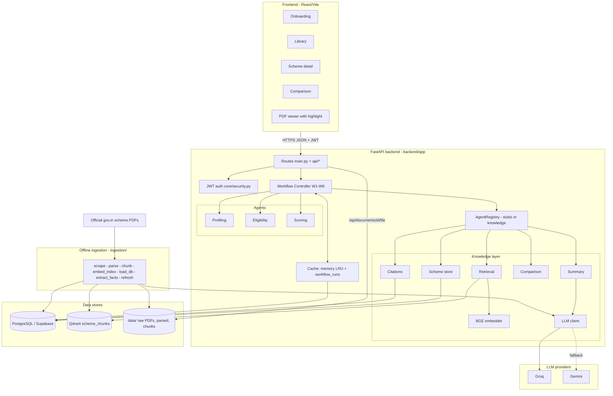

### 2.3 Module dependency rule (enforced by `test_import_graph.py`)

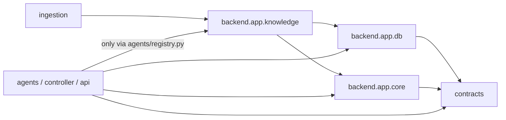

### 2.4 Data model (main tables)

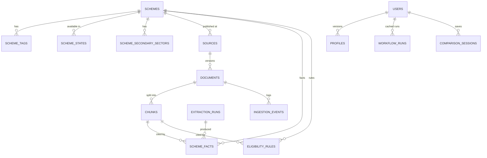

### 2.5 API surface

| Area | Endpoints |
|---|---|
| Auth | `POST /api/auth/register`, `POST /api/auth/login`, `GET /api/me` |
| Onboarding (W1) | `GET /api/onboarding/next`, `POST /api/onboarding/answer` |
| Profile (W5) | `GET /api/profile`, `PUT /api/profile`, `POST /api/profile/questions` |
| Library (W2) / Detail (W3) | `GET /api/library`, `GET /api/schemes/{scheme_id}` |
| Comparison (W4) | `GET /api/comparison/options`, `POST /api/comparison` |
| Citations | `GET /api/citations/{citation_id}`, `GET /api/documents/{doc_id}/file` |
| Admin (W6) / Health | `POST /api/admin/refresh`, `GET /api/health` |

---

## 3. Multi-agent workflows

The system uses a **controller-orchestrated (hub-and-spoke) multi-agent design**. Agents never call each other.
The `WorkflowController` loads what each agent needs into a shared `WorkflowState`, calls the agents in order,
records a trace step per agent, and caches the result keyed by `(workflow, user, profile_version)`.

| Agent | Kind | Responsibility |
|---|---|---|
| Profiling | deterministic | Picks the next question (`show_if`, `text_if`, `option_show_if`), validates answers, prunes follow-ups that no longer apply |
| Retrieval | deterministic + vectors | Profile → candidate schemes; scheme → evidence chunks |
| Eligibility | deterministic | Evaluates rules → `ELIGIBLE` / `PARTIALLY_ELIGIBLE` / `NOT_ELIGIBLE` / `NEEDS_VERIFICATION` |
| Scoring | deterministic | P/E/N/B components → match %, then builds the library |
| Summary | LLM + validator | Cited plain-language summary; falls back to stored facts if the LLM is down |
| Comparison | deterministic | Side-by-side matrix from verified facts, plus cited insights |
| Citation | deterministic | Validates citation IDs; resolves them to PDF page and bbox |
| Extraction (offline) | LLM + validator | Proposes facts and rules from chunks; code verifies before storing |

### 3.1 Overview: workflows W1–W6

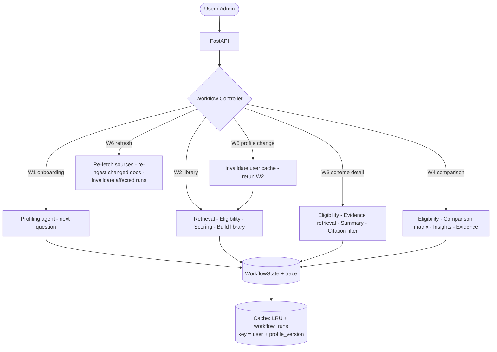

### 3.2 W1: adaptive onboarding

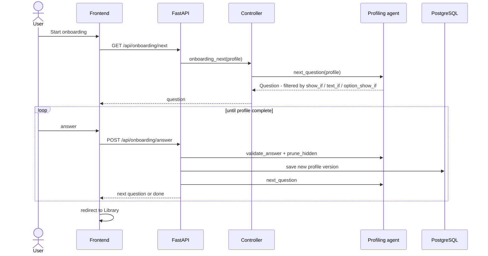

### 3.3 W2: personalised library

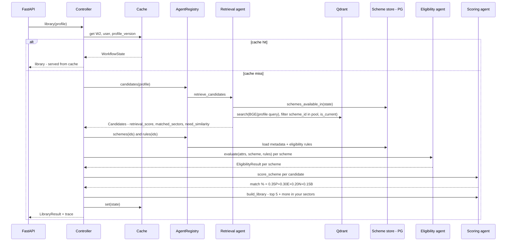

### 3.4 W3: scheme detail (RAG + cited summary)

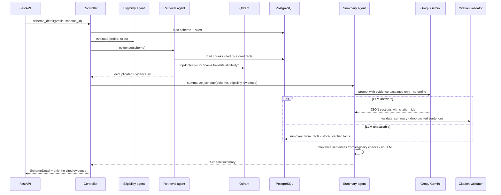

### 3.5 W4: comparison

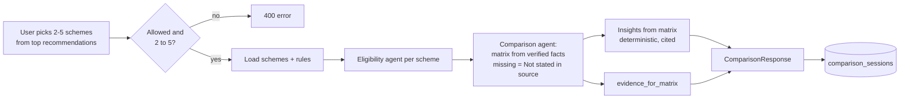

### 3.6 W5 and W6: profile change and source refresh

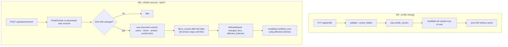

### 3.7 Eligibility agent decision logic

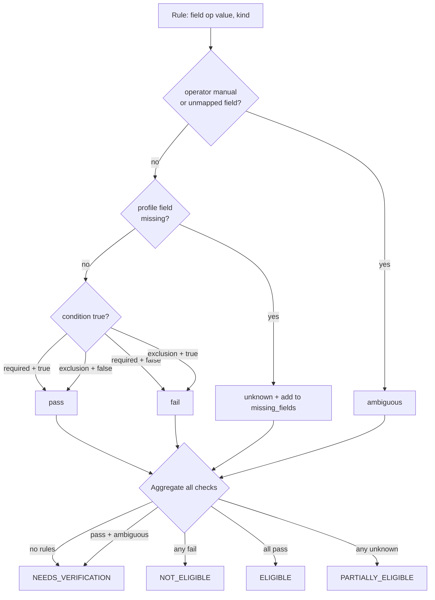

### 3.8 LLM client: provider fallback

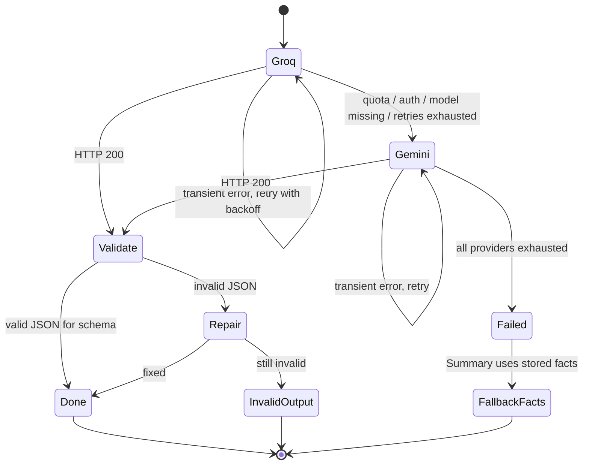

---

## 4. RAG (retrieval-augmented generation)

RAG has two halves: **offline indexing** (build the knowledge base once and refresh it) and **online retrieval +
grounded generation** (per request). A citation guardrail sits between generation and the user.

### 4.1 Offline indexing pipeline

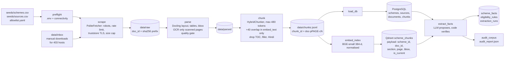

### 4.2 Online retrieval + grounded generation

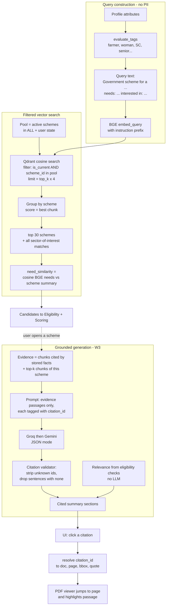

### 4.3 Hallucination guardrails (where each check happens)

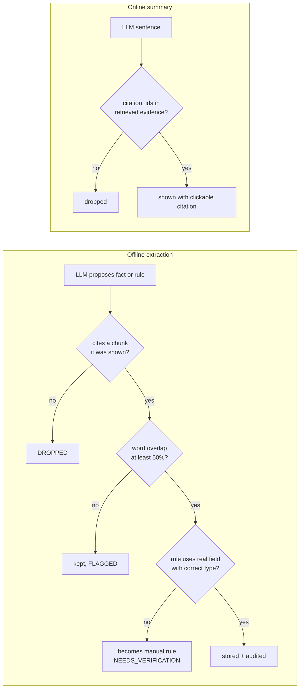

### 4.4 RAG design choices

| Choice | Reason |
|---|---|
| Section-aware chunks, not fixed windows | Eligibility clauses and benefit tables stay intact |
| Overlap only in `embed_text` | Better recall, while citations quote the exact source text |
| Metadata filter before ranking (state, `is_current`) | Never retrieve schemes the user cannot apply for, or outdated versions |
| Scheme-level aggregation (best chunk) | Ranking is per scheme, not per passage |
| Small CPU model (BGE-small, 384-d) | Runs on a laptop; the same tokenizer is used for chunk sizing |
| `citation_id == chunk_id`, deterministic Qdrant point IDs | Re-indexing is idempotent and citations are stable across versions |
| Profile never sent to the LLM | Privacy; personal relevance stays deterministic and auditable |
| Stored-facts fallback | The detail page still works when free-tier LLM quotas run out |

---

## 5. End-to-end in one picture

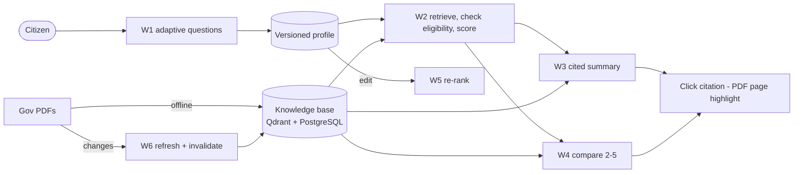
